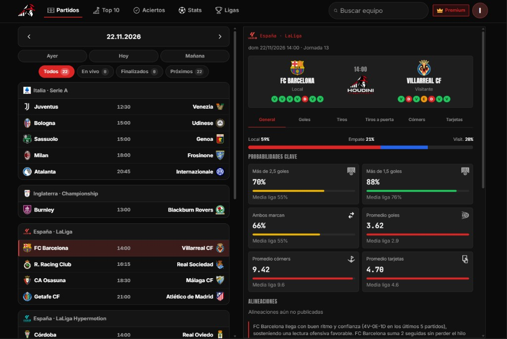
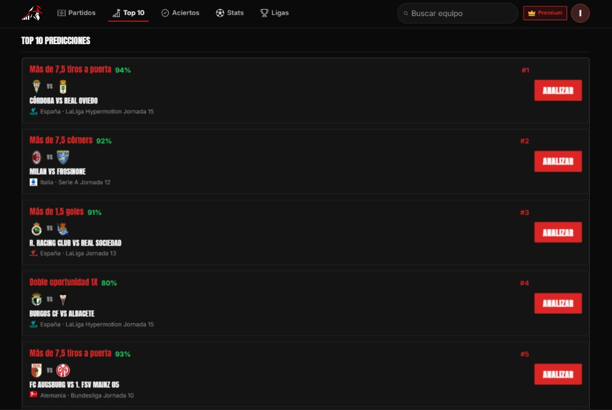
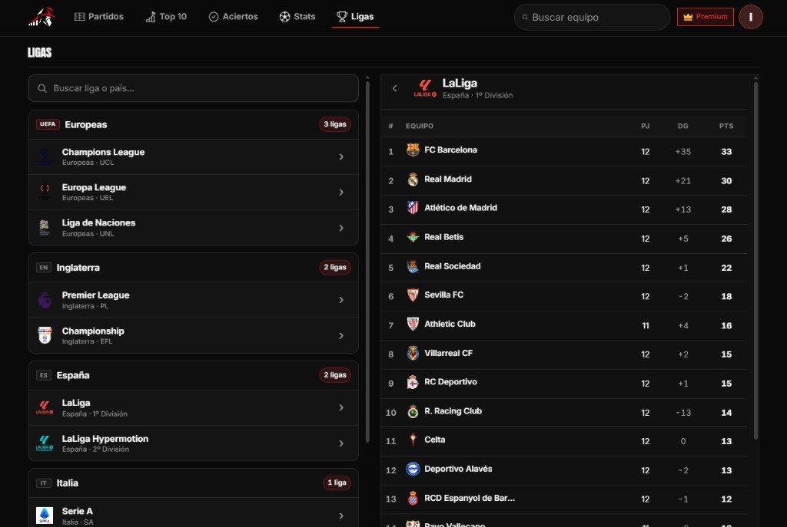
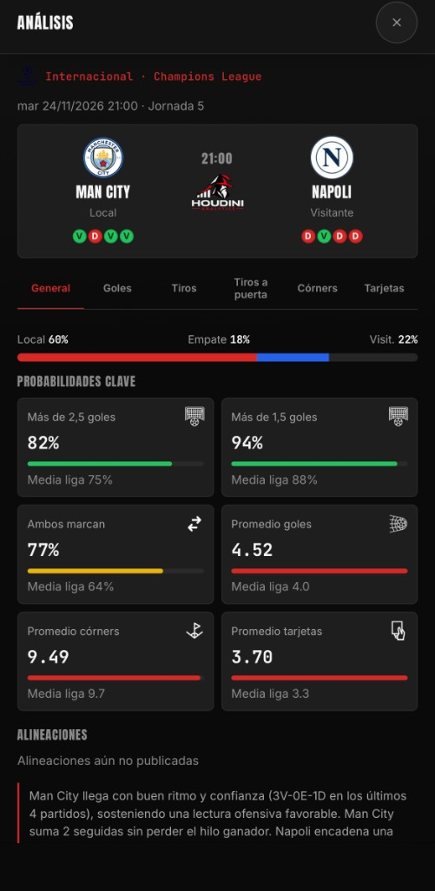
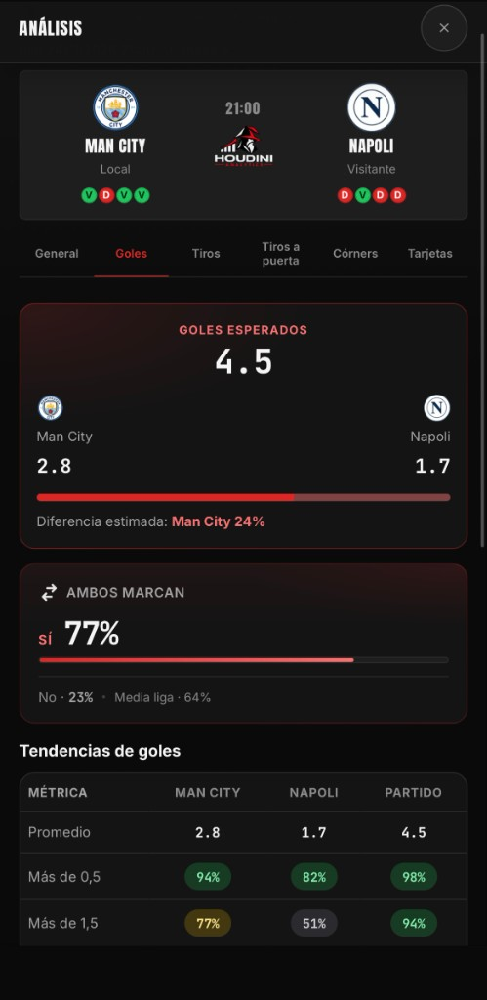
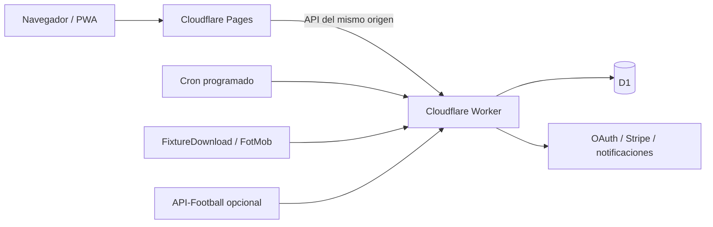

<p align="center">
  
</p>

<h1 align="center">Houdini Analytics</h1>

<p align="center">
  <strong>Análisis de fútbol con modelos probabilísticos y seguimiento en directo.</strong><br />
  Partidos · Top 10 · Aciertos · Estadísticas · Ligas
</p>

<p align="center">
  <a href="https://houdini-analytics.pages.dev"></a>
</p>

<p align="center">
  <a href="#el-proyecto"></a>
  &nbsp;
  <a href="docs/MODEL.md"></a>
  &nbsp;
  <a href="docs/ARCHITECTURE.md"></a>
</p>

<p align="center">
  <a href="#inicio-rápido">Desarrollo</a> ·
  <a href="#documentación">Documentación</a> ·
  <a href="docs/QUALITY.md">Calidad</a>
</p>



## El proyecto

Houdini Analytics reúne calendario, resultados, estadísticas y estimaciones de mercados de fútbol en una interfaz web adaptable. El motor combina Poisson, ajuste Dixon–Coles e información histórica; el seguimiento en vivo actualiza las proyecciones a partir del estado del partido.

El frontend está desarrollado con HTML, CSS y JavaScript. La aplicación utiliza Cloudflare Pages, una API en Workers y una base D1. El backend Express/MySQL se conserva como legado, separado del runtime actual.

**Interpretar las cifras:** el intervalo 78–95 % corresponde a la banda de probabilidad estimada que utiliza el modelo para seleccionar tips. La evaluación de aciertos, calibración y cobertura requiere resultados históricos y muestras suficientes. No se ofrece una garantía de resultados o rentabilidad.

## Experiencia de producto

| Área                 | Qué permite consultar                                                                                        |
| -------------------- | ------------------------------------------------------------------------------------------------------------ |
| **Partidos**         | Calendario, estados, resultados y acceso al análisis de cada encuentro                                       |
| **Top 10**           | Hasta diez selecciones del día elegido, ordenadas por probabilidad del modelo y dentro del universo admitido |
| **Aciertos**         | Seguimiento diario de selecciones: acertada, fallada, anulada o pendiente                                    |
| **Estadísticas**     | Medias por partido y métricas de goles, tiros, tiros a puerta, córners y tarjetas                            |
| **Ligas**            | Catálogo, buscador, clasificaciones y navegación por equipos                                                 |
| **Cuenta y Premium** | Sesiones de usuario, Google OAuth opcional, gestión de perfil e integración de suscripciones con Stripe      |
| **Móvil y PWA**      | Navegación inferior, paneles adaptados, manifest y service worker                                            |

La disponibilidad de las integraciones depende de su configuración y de los proveedores. El [estado de verificación](docs/QUALITY.md) identifica las comprobaciones realizadas y los pendientes.

### Capturas

Las imágenes proceden de las capturas ya incluidas en el proyecto y representan una versión concreta de la interfaz.

| Top 10                                                                  | Ligas                                                                    |
| ----------------------------------------------------------------------- | ------------------------------------------------------------------------ |
|  |  |

<details>
<summary>Ver la experiencia móvil y el análisis</summary>

<p>
  
  
  
</p>

</details>

## Arquitectura de un vistazo



| Componente        | Implementación                                                        |
| ----------------- | --------------------------------------------------------------------- |
| Interfaz          | HTML, CSS y JavaScript, sin framework de frontend                     |
| API               | Cloudflare Worker con rutas `/api/v1`                                 |
| Persistencia      | D1 y migraciones SQL versionadas                                      |
| Modelo            | Poisson, Dixon–Coles y estimaciones separadas para mercados de conteo |
| Datos             | FixtureDownload y FotMob; enriquecimiento opcional con API-Football   |
| Identidad y pagos | Sesiones opacas, OAuth de Google e integración Stripe                 |
| Regresión         | Scripts Node.js de lógica y comprobaciones de interfaz estáticas      |

Más detalle en [arquitectura](docs/ARCHITECTURE.md), [modelo](docs/MODEL.md) y [datos](docs/DATA_MODEL.md).

## Inicio rápido

Requisitos: Git, Node.js 22 y npm. El entorno de comprobación utilizó Node.js 22.22.2.

La rama predeterminada de este repositorio es **`analytics-hb139`**. La rama remota `main` conserva otra base; usar la rama predeterminada para reproducir la versión documentada.

```sh
git clone --branch analytics-hb139 https://github.com/ivanmarrtin27/Houdini-Analytics-v1.1.git
cd Houdini-Analytics-v1.1/cloudflare
npm ci
npm run db:local
npm run dev
```

Wrangler imprime la URL local, normalmente `http://localhost:8787`. La base local es independiente de producción. Las credenciales y servicios externos se configuran por entorno: consultar [desarrollo](docs/DEVELOPMENT.md).

```sh
npm test
```

La suite tiene incidencias previas documentadas. Ver [pruebas y calidad](docs/QUALITY.md) para resultados, límites y reproducción; no se presenta como una validación integral de producción.

## Documentación

| Quiero…                                              | Guía                                           |
| ---------------------------------------------------- | ---------------------------------------------- |
| Entender las pantallas y los estados                 | [Producto](docs/PRODUCT.md)                    |
| Preparar el entorno y trabajar en el repositorio     | [Desarrollo](docs/DEVELOPMENT.md)              |
| Conocer componentes, flujos y cron                   | [Arquitectura](docs/ARCHITECTURE.md)           |
| Interpretar probabilidades y selección de tips       | [Modelo probabilístico](docs/MODEL.md)         |
| Entender tablas y migraciones                        | [Modelo de datos](docs/DATA_MODEL.md)          |
| Consultar rutas y contratos de lectura               | [Referencia de API](docs/API.md)               |
| Preparar un despliegue o diagnosticar una incidencia | [Operación y despliegue](docs/OPERATIONS.md)   |
| Configurar cuentas y OAuth                           | [Autenticación](cloudflare/docs/AUTH_SETUP.md) |
| Configurar suscripciones                             | [Stripe](cloudflare/docs/STRIPE_SETUP.md)      |
| Consultar lo verificado y lo pendiente               | [Pruebas y calidad](docs/QUALITY.md)           |
| Proponer cambios                                     | [Contribución](CONTRIBUTING.md)                |
| Gestionar secretos y datos sensibles                 | [Seguridad](SECURITY.md)                       |

## Estructura del repositorio

```text
cloudflare/
  src/             API, acceso a datos y servicios de dominio
  public/          Fuentes de la interfaz y recursos estáticos
  pages/           Archivos preparados para el despliegue de Pages
  admin-pages/     Interfaz interna de operación
  migrations/      Evolución del esquema D1
  scripts/         Pruebas, comprobaciones y herramientas
  docs/            Configuración específica de integraciones
docs/              Documentación pública y capturas
legacy/backend/    Backend Express/MySQL y CLI conservados como legado
```

`public/` y `pages/` son directorios distintos. Antes de publicar hay que verificar qué archivos se despliegan y preservar el proxy de Pages. No existe un comando `build` en el `package.json` actual; el proceso está descrito en [operación](docs/OPERATIONS.md).

## Estado y límites

La revisión documental del **25 de noviembre de 2026** confirmó respuestas HTTP 200 de la aplicación, `/health` y `/api/v1/status`. El estado público indicó datos de FixtureDownload y autenticación rechazada para el enriquecimiento opcional de API-Football. La configuración de pagos, OAuth y correo debe verificarse por separado.

La documentación distingue implementación, configuración y evidencia. Los informes de calidad no equivalen a una auditoría de seguridad o certificación del modelo.

## Autor y uso

Desarrollado por **[Iván Martín Molina](https://github.com/ivanmarrtin27)**.

Proyecto de uso personal y portfolio. No se ha concedido una licencia open source en este repositorio. Los pronósticos tienen finalidad informativa; deben interpretarse con sus supuestos, cobertura y limitaciones.
