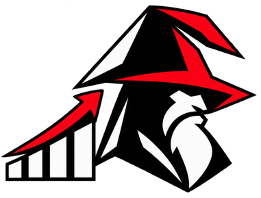
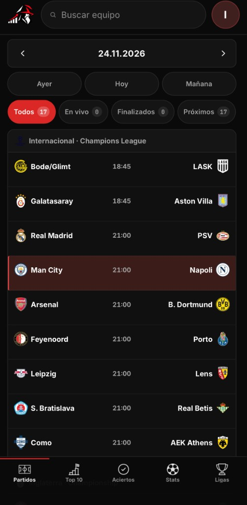

<p align="center">
  
</p>

<h1 align="center">Houdini Analytics</h1>

<p align="center">
  <strong>Predicciones de fútbol con modelo Poisson</strong><br>
  <sub>Tip lane 78–95% · en vivo · PWA dark/red en Cloudflare</sub>
</p>

<p align="center">
  <a href="https://houdini-analytics.pages.dev"></a>
  &nbsp;
  <a href="https://houdini-analytics-admin.pages.dev"></a>
</p>

<p align="center">
  <a href="https://houdini-analytics.pages.dev"></a>
  
  
  
</p>

<p align="center">
  
  
  
  
  
  
  
</p>

<p align="center">
  <a href="#producto">Producto</a>
  ·
  <a href="#stack">Stack</a>
  ·
  <a href="#desarrollo">Dev</a>
  ·
  <a href="#deploy">Deploy</a>
  ·
  <a href="#capturas">Capturas</a>
</p>

---

## Producto

App de predicciones (Poisson + Dixon–Coles). Tips rankeados solo por **P del modelo** (banda playable **78–95%**).

| | |
|---|---|
| **App** | [houdini-analytics.pages.dev](https://houdini-analytics.pages.dev) |
| **Admin** | [houdini-analytics-admin.pages.dev](https://houdini-analytics-admin.pages.dev) |
| **API** | `houdini-bet…workers.dev` → `/api/v1/…` · `/health` |

- **Partidos** — hoy + 14 días · top5 + Segunda + Championship + UNL/UCL/UEL · live
- **Top 10 / Aciertos** — tip primary allowlist · hit / miss / void / pending
- **Stats · Ligas · Panel** — medias, tablas, 1X2 / O-U / BTTS / córners / tarjetas / SOT
- **Auth · Premium** — cookie + Google · Stripe (Mensual / Trimestral / Anual)
- **Datos** — cron FixtureDownload + FotMob · enrich opcional API-Football

Docs: [Admin](./cloudflare/docs/ADMIN_PANEL.md) · [Auth](./cloudflare/docs/AUTH_SETUP.md) · [Stripe](./cloudflare/docs/STRIPE_SETUP.md)

> Pronósticos **informativos**. No son asesoramiento financiero. Juega con responsabilidad.

## Stack

| | |
|---|---|
| Frontend | Pages `houdini-analytics` (`cloudflare/public` → `pages/`) |
| API | Worker `houdini-bet` |
| DB | D1 `houdini-bet-db` (aislado) |
| Admin | Pages `houdini-analytics-admin` |
| Cron | sync `0 6 * * *` · enrich `30 6 * * *` |
| Ligas | `140,141,39,40,135,78,61,5,2,3` |

Producción en [`cloudflare/`](./cloudflare). Legacy Express/MySQL en [`legacy/`](./legacy/).

```
cloudflare/
├── public/          # PWA
├── pages/           # deploy Pages
├── admin-pages/     # admin
├── src/             # Worker + servicios
├── migrations/      # D1
├── docs/            # setup
└── scripts/
```

## Desarrollo

Node.js LTS + [Wrangler](https://developers.cloudflare.com/workers/wrangler/).

```bash
cd cloudflare
npm install
npx wrangler d1 migrations apply houdini-bet-db --local
npm run dev          # o: npx wrangler dev
npm test
```

## Deploy

```bash
cd cloudflare
npx wrangler deploy
npx wrangler pages deploy pages --project-name houdini-analytics --branch main
npx wrangler pages deploy admin-pages --project-name houdini-analytics-admin --branch main
npx wrangler d1 migrations apply houdini-bet-db --remote
```

Secrets (`wrangler secret put`, nunca en git): `SYNC_SECRET`, `AUTH_SECRET`, Google OAuth, `STRIPE_*`, opcional `API_FOOTBALL_KEY` / `CF_*`.

### API (resumen)

| | Ruta |
|---|---|
| GET | `/api/v1/status` · `/matches/today` · `/matches/best-bets` |
| GET | `/tips/day-results` · `/stats/match-averages` · `/matches/:id/prediction` |
| GET | `/leagues/:apiId/table` |
| POST | `/sync/manual` · `/premium/checkout` (+ webhook Stripe) |

## Capturas

| Vista | | |
|-------|---|---|
| Partidos |  | Lista del día + panel de análisis |
| Ligas |  | Catálogo, logos y tablas |
| Móvil |  | Chips, escudos, tabbar |
| Análisis |  | O1.5 · O2.5 · BTTS · medias |

## Autor

[Iván Martín Molina](https://ivanmartin.pages.dev/) · [@ivanmarrtin27](https://github.com/ivanmarrtin27)

Uso personal / portfolio — sin licencia open-source por ahora.
