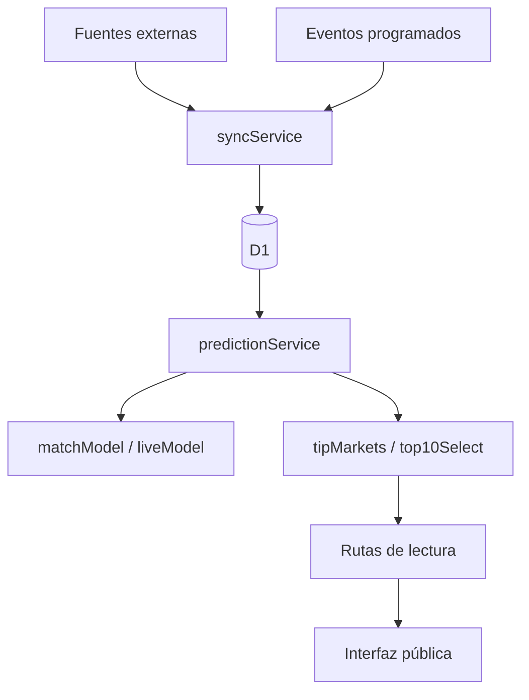

# Arquitectura

## Componentes y responsabilidades

| Componente       | Responsabilidad                                                        | Fuente                     |
| ---------------- | ---------------------------------------------------------------------- | -------------------------- |
| Interfaz pública | Navegación por hash, paneles, cuenta, traducciones y presentación      | `cloudflare/public/`       |
| Paquete de Pages | Estáticos publicados y proxy de API/health al Worker                   | `cloudflare/pages/`        |
| Worker           | Rutas HTTP, coordinación, tareas programadas y bindings                | `cloudflare/src/index.js`  |
| Acceso a datos   | Consultas, persistencia y agregaciones en D1                           | `cloudflare/src/db.js`     |
| Dominio          | Sincronización, predicción, selección, directo, cuenta y suscripciones | `cloudflare/src/services/` |
| Administración   | Interfaz interna desplegada por separado                               | `cloudflare/admin-pages/`  |
| Legado           | Express/MySQL y CLI anteriores                                         | `legacy/backend/`          |

La API del navegador usa el mismo origen de la aplicación. Pages sirve estáticos y reenvía `/api/*` y `/health` al Worker de origen mediante su `_worker.js`. El Worker también puede servir recursos a través del binding `ASSETS`.

## Recorrido de los datos

FixtureDownload aporta calendarios y resultados; FotMob complementa fuentes domésticas, internacionales y datos del partido. API-Football añade enriquecimiento cuando su clave, autorización y presupuesto lo permiten. Las identidades externas se conservan separadas de los identificadores internos.

La capa de predicción obtiene historial y medias, estima parámetros, construye probabilidades y persiste resultados. La selección pública vuelve a escoger el tip principal permitido a partir de probabilidades disponibles para evitar arrastrar etiquetas antiguas.

Algunas lecturas realizan mantenimiento, enriquecimiento o cálculo diferido. Por tanto, un GET del producto no debe considerarse un acceso de auditoría estrictamente libre de efectos sobre la base o las fuentes.

## Tiempo real y caché

`liveModel.js` proyecta mercados a partir de minuto, marcador y parámetros previos. `syncService.js` coordina refresco, eventos, reparación de estados y liquidación de selecciones pendientes.

El código incorpora cachés breves por isolate para listas, predicciones y clasificaciones, y cabeceras de caché en ciertas respuestas. Esas cachés y los límites en memoria no son almacenamiento ni coordinación global entre todos los isolates.

La actualización en vivo tiene un cooldown de petición y un cron condicionado al trabajo pendiente. Su frecuencia efectiva depende de fuentes, ejecución, caché y cobertura; no es un stream de eventos garantizado al segundo.

## Programación actual

Los valores proceden de [`wrangler.jsonc`](../cloudflare/wrangler.jsonc) y del manejador `scheduled`. Las horas de cron son UTC:

| Expresión          | Función                                                                          |
| ------------------ | -------------------------------------------------------------------------------- |
| `0 6 * * *`        | Sincronización diaria                                                            |
| `30 6 * * *`       | Enriquecimiento de API-Football, sujeto a configuración                          |
| `0 12 * * *`       | Segundo intento programado de enriquecimiento                                    |
| `*/10 11-23 * * *` | Revisión de directo cada diez minutos, entre las 11 y las 23 UTC, si hay trabajo |

Existe además una comprobación de antigüedad de sincronización en algunas lecturas, con referencia de doce horas. El horario local cambia según la zona y el horario de verano.

## Cuenta y suscripciones

`authService.js` gestiona contraseñas con Web Crypto, sesiones opacas y OAuth. D1 guarda usuarios y sesiones. Premium y Stripe se coordinan desde `premiumService.js`, con webhook y referencias persistidas. Los tickets de soporte y las notificaciones se separan para que el almacenamiento no dependa de la entrega del correo.

No se debe confundir el acceso visible del frontend con los permisos efectivos de cada ruta. La seguridad se comprueba por endpoint y por operación; ver [seguridad](../SECURITY.md).

## Directorios de interfaz

`public/` y `pages/` están versionados por separado. El proyecto no tiene un script `build` que los genere automáticamente. Una publicación de Pages sirve los archivos de `pages/`, mientras el Worker con assets utiliza `public/`. Una divergencia entre ambos puede producir versiones distintas de la UI.

Esta revisión documental no sincroniza ni reescribe esos recursos y no despliega ninguna aplicación. Ver [operación](OPERATIONS.md) para una publicación controlada.
